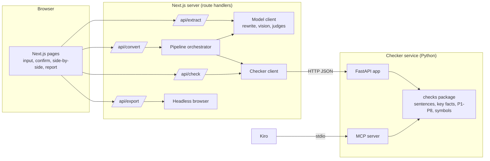
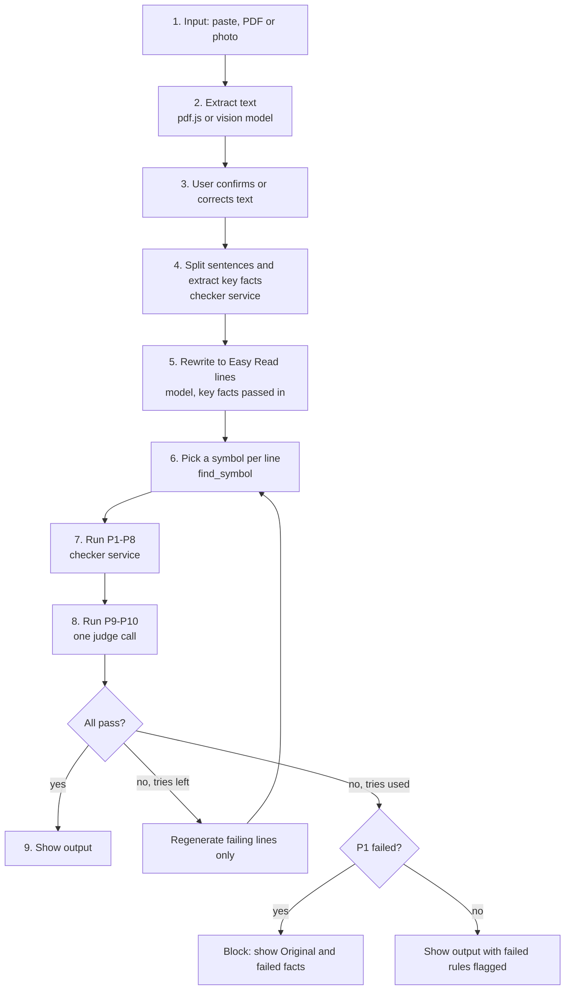
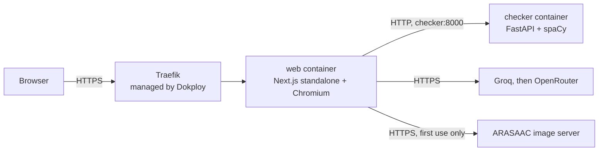

# Design Document

## Overview

Easy Read Engine has two parts:

- **Web app (Next.js, TypeScript).** Serves the UI and the API through App Router route handlers. It owns every model call (vision extraction, the Easy Read rewrite, the P9 and P10 judges), runs the convert-check-regenerate loop, renders the side-by-side view and exports the PDF. There is no separate Node backend.
- **Checker service (Python, spaCy).** Owns everything deterministic: sentence splitting, key-fact extraction, the P1 to P8 checkers and the symbol index. The same functions are exposed two ways: over HTTP for the route handlers, and as an MCP server for Kiro.

The pipeline checks before it shows. Key facts are pulled from the Original before the rewrite, so P1 compares the output against the source, not against the model's own output.

Requirements: `requirements.md` (R1 to R9, P1 to P10). Source brief: `docs/brief.md`.

### Design decisions

| Decision | Choice | Reason |
| --- | --- | --- |
| API layer | Next.js route handlers, Node.js runtime | One TypeScript codebase for UI and API. Node runtime (not Edge) because pdf.js and the headless browser need it |
| UI components | shadcn/ui with Tailwind CSS | Accessible Radix-based components copied into the repo, so they can be adjusted for Easy Read sizing |
| Where LLM calls live | Web app only | One place holds model keys and the `prompts/` folder. The checker service stays model-free, so Hypothesis tests are deterministic and fast |
| Where key-fact extraction lives | Checker service | P1 uses the same extractor on both sides; spaCy NER is in Python |
| Where the symbol index lives | Checker service | `find_symbol` is an MCP tool and P8 needs the index, so both read one copy |
| Checker HTTP framework | FastAPI | Pydantic models give request validation and an OpenAPI schema |
| Shared types | OpenAPI from FastAPI, TypeScript types generated with `openapi-typescript` | The Python models are the single source of truth for the data contract |
| MCP server | Official Python MCP SDK (`mcp`, FastMCP), stdio transport | Thin wrapper over the same functions the HTTP app calls |
| Attempts | 3 tries in total: 1 first conversion plus up to 2 regenerations | Matches the brief's "until every rule passes or three tries are used up" |
| Fact comparison | Compare normalised values (see Key-fact normalisation) | "1 March 2026" and "1/3/2026" are the same date; a changed digit is not |
| Model provider | Groq free plan first, OpenRouter free models as fallback; Gemini free tier in development only (see Model provider) | $0 with no card. Groq doesn't keep or train on prompts by default. Gemini's terms forbid its free tier in apps offered to UK users |
| Judges | One judge call per try returns P9 and P10 (including the advice check) for every line | Halves the requests per try, which matters under free-tier daily limits |
| Symbol library | ARASAAC (CC BY-NC-SA) | About 13,000 pictograms with an English search API; the non-commercial licence fits this project (see Symbols) |
| Hosting | Hetzner VPS (16 GB RAM) via Dokploy, Docker Compose, at `easyread.wendyji.com` | Your existing setup; runs the Python service and Chromium without serverless size limits (see Deployment) |

## Architecture



### Conversion pipeline



The brief's pipeline image was not readable as text, so these nine steps are reconstructed from its requirements and design notes.

## Components and Interfaces

### Folder layout

```
web/                         Next.js app
  app/
    page.tsx                 input and confirm screen
    result/page.tsx          side-by-side view and rule report
    print/page.tsx           A4 print layout, used by export
    api/extract/route.ts
    api/convert/route.ts
    api/check/route.ts
    api/export/route.ts
  components/ui/             shadcn/ui components
  src/
    pipeline/                orchestrator, retry loop, block/flag decision
    llm/                     model client, rewrite, vision, judges
    checker-client/          typed HTTP client for the checker service
    types/checker.ts         generated from the checker OpenAPI schema
  tests/                     fast-check and unit tests
prompts/                     rewrite, regenerate, vision, P9 and P10 judge prompts
checker/                     Python service
  src/checks/
    sentences.py
    key_facts.py
    p1_key_facts.py ... p8_symbols.py
    symbols.py
    wordlist/                common-word list for P5
  src/http_app.py            FastAPI adapter
  src/mcp_server.py          MCP adapter
  tests/                     Hypothesis properties, checker-must-fail cases, mutation test
fixtures/letters/            public sample and invented letters (no real personal data)
```

The hook paths in the brief still match: `checker/src/checks/` for checker tests, and `prompts/` for the fixture run.

### Web route handlers

All handlers run with `export const runtime = "nodejs"` and validate input at the boundary (zod). Nothing is written to disk or a database (R7.4).

| Route | Input | Output | Requirements |
| --- | --- | --- | --- |
| `POST /api/extract` | multipart: `file` (PDF or image) | `{ text }` or `{ error: "handwriting" \| "unreadable" \| "unsupported_type" }` | R1 |
| `POST /api/convert` | `{ original: string }` (confirmed text) | `ConversionResult` | R2, R3, R4, R6, R7 |
| `POST /api/check` | `{ original, lines, editedLineIds, previousChecks }` | `{ status, checks, lines, lineFacts, sentences, keyFacts, judgeAvailable, models }` | R9, R2, R3, R6 |
| `POST /api/export` | `ConversionResult` | `application/pdf`, A4 | R8 |

- **`/api/extract`.** PDFs go through pdf.js (`pdfjs-dist`). If a PDF has no text layer, it is treated as an image. Images go to the vision model with a prompt that first classifies the page as printed or handwritten. Handwritten pages return `error: "handwriting"` and the UI shows the message from R1.4.
- **`/api/convert`.** Calls the pipeline orchestrator. Free models can be slow, and 3 tries may take a minute or more, so the handler streams newline-delimited JSON: progress events ("Checking, try 2 of 3") and then the final `ConversionResult`. The stream keeps the connection active through the proxy and shows the user that work is happening.
- **`/api/check` (R9).** Called when the user saves an edit, not on every keystroke. It re-runs P1 to P8 on all lines, and runs the judge on `editedLineIds` only, so one edit costs one model request. It returns the same `status` rules as `/api/convert`. It never regenerates lines: the user's text is kept as written. The demo uses this route to show one changed date turning P1 red and blocking the output. Decisions (task 26):
  - **Key facts come from the server.** The handler runs `analyse` on the Original again and uses those sentences and key facts for P1, the judge's source sentences and `/line-facts`. Key facts sent by the client are ignored, so P1 always compares the output with the Original (R2.4). A line whose `source_sentence_id` isn't in that analysis is a 400.
  - **Earlier P9 and P10 verdicts travel in the request.** The client sends its current checks as `previousChecks`. The server keeps their P9 and P10 failures for lines that are still there and weren't edited, adds the judge's verdicts for the edited lines (`web/src/check/merge.ts`), and decides the status from all 10 rules. A previous failure that names no line stays failed. These carried verdicts are only as trustworthy as the client, which can affect only its own screen; P1 to P8 always run on the server, so a block can't be avoided this way.
  - **Pictures are not attached again.** The user's `symbol_id`s are kept and P8 validates them.
  - **A blocked edit returns no lines**, as in R2.5. The client keeps earlier results in memory (an undo stack of up to 20, never stored, R7.4), so "Undo edit" restores the result before the edit exactly, with no server call.
  - Order: zod and size checks (400, 413), checker health (503, before any model call), then the shared rate limit (route `check`, cost 1).
- **Rate limiting.** `/api/extract`, `/api/convert` and `/api/check` share the free-tier daily allowances (see Model provider), so each has a per-IP limit (in-memory token bucket, for example 10 conversions per IP per hour). When the limit is hit, the route returns 429 with a plain message.
- **`/api/export`.** Renders `print/page.tsx` with the result and prints it to PDF in a headless browser (Playwright or Puppeteer with Chromium), A4, background graphics on.

### Pipeline orchestrator (`web/src/pipeline`)

```ts
async function convert(original: string): Promise<ConversionResult> {
  const { sentences, keyFacts } = await checker.analyse(original);   // step 4
  let lines = await llm.rewrite(original, sentences, keyFacts);      // step 5
  for (let attempt = 1; ; attempt++) {
    lines = await attachSymbols(lines);                              // step 6
    const checks = [
      ...(await checker.check(original, keyFacts, lines)),           // step 7, P1-P8
      ...(await llm.judge(sentences, lines)),                        // step 8, P9-P10
    ];
    const failed = failingLineIds(checks);
    if (failed.size === 0 || attempt === MAX_ATTEMPTS) {
      return decide(original, sentences, keyFacts, lines, checks, attempt);
    }
    lines = await llm.regenerate(lines, failed, checks, keyFacts);   // only failing lines
  }
}
```

- `MAX_ATTEMPTS = 3`.
- `decide` returns `status: "blocked"` if P1 failed, `"flagged"` if any other rule failed, otherwise `"passed"`.
- If P1 fails because a fact is missing rather than wrong, the failing lines are the lines whose source sentence holds that fact. If no line maps to that sentence, the regenerate prompt gets the fact and is told to add a line.
- `regenerate` replaces only the lines in `failed`; other lines keep their IDs and text. This is what the fast-check tests assert.

### Model client (`web/src/llm`)

A small interface over OpenAI-compatible chat completions APIs. Groq, OpenRouter and Gemini all offer one, so one client covers every provider in the chain (see Model provider):

```ts
interface ModelClient {
  extractText(image: Uint8Array): Promise<{ handwritten: boolean; text: string }>;
  rewrite(input: RewriteInput): Promise<DraftLine[]>;
  regenerate(input: RegenerateInput): Promise<DraftLine[]>;
  // One request returns P9 and P10 for every line passed in
  judge(pairs: { lineId: string; source: string; line: string }[]): Promise<[CheckResult, CheckResult]>;
}
```

- Prompts are loaded from `prompts/` so the prompt hook can test them.
- The rewrite returns JSON: per line, `text`, `sourceSentenceId` and a short `symbolQuery` (for example "doctor", "pay money"). Structured-output support differs by provider and model, so the JSON shape is requested through a tool definition and validated with zod. Invalid JSON gets one retry (see Error Handling).
- The rewrite and regenerate prompts include the Easy Read rules from `.kiro/steering/easy-read-rules.md` and the safety rules from `.kiro/steering/safety.md`: no advice, no telling the reader what to decide (R7.2).
- The judge returns, per line, a verdict and a one-line reason for each of: meaning kept (P9), respectful tone (P10) and no advice (P10, R7.3). A line fails P10 if either the tone or the advice verdict fails. Every failure maps to a line ID.

### Model provider (free tiers only, no card)

Constraint: no money spent on model APIs. Everything below was checked in November 2026. Free tiers change often, so re-check each one on day 1.

**Providers considered:**

| Provider | Free terms | Verdict |
| --- | --- | --- |
| **Groq** (primary) | Free plan, no card. `openai/gpt-oss-120b` and `qwen/qwen3.8-27b` each get 30 requests a minute, 1,000 a day, 8,000 tokens a minute and 200,000 tokens a day ([Groq rate limits](https://console.groq.com/docs/rate-limits), [free plan summary, 29 Oct 2026](https://byoklist.com/guides/groq-api-key)). Inputs and outputs aren't kept by default or used for training, and the short-term logs can be switched off in Data Controls ([Your data in GroqCloud](https://console.groq.com/docs/your-data)) | **Use.** Best privacy of the free options, fast, and two capable models with separate daily allowances |
| **OpenRouter** (fallback) | `:free` models, no card: 20 requests a minute and 50 a day, shared across all free models ([OpenRouter limits](https://openrouter.ai/docs/api/reference/limits)). Several free hosts may train on prompts ([TrueFoundry](https://www.truefoundry.com/blog/openrouter-free-models-whats-actually-free-and-what-it-costs-you)), and the free list changes monthly | **Use as fallback** for when Groq's daily tokens run out, and as the vision fallback |
| **Google AI Studio** (Gemini API) | Free tier with per-model limits, for example 500 requests a day on Gemini 3.5 Flash-Lite and 20 a day on Gemini 3.8 Flash ([summary, Oct 2026](https://www.scriptbyai.com/gemini-api-free-tier-limits/)). But Google's terms say that apps made available to users in the EEA, Switzerland or the **UK** may use only Paid Services ([Gemini API terms](https://aistudio.google.com/docs/terms)) | **Development only.** The app is for UK letters and UK readers, so the live site can't use the free tier. Your own local runs and hooks aren't an app offered to users, so Gemini can back up the fixture hook |
| **Cerebras** | No permanent free tier since July 2026. New accounts get a one-time $5 credit after adding a card, and it expires after 30 days. The trial allows 5 requests a minute and 1M tokens a day ([Cerebras rate limits](https://inference-docs.cerebras.ai/support/rate-limits)) | **Don't use.** It needs a card and would stop working partway through judging |
| Self-hosted on the VPS | No API limits. A small model on CPU would take minutes per conversion on a 16 GB server that also runs Chromium | **Not now.** It's an option later if every free API disappears |

**Chain by role.** Each role is an ordered env list of `provider:model` entries. The model client tries them in order and moves on after a 429, a 5xx or a timeout. Every result records which provider and model answered.

| Role | Production (`easyread.wendyji.com`) | Development (local `.env`) |
| --- | --- | --- |
| Rewrite and regenerate | `groq:openai/gpt-oss-120b` → `openrouter:nvidia/nemotron-3-ultra-550b-a55b:free` | same, then `gemini:gemini-3.5-flash-lite` |
| Judge (P9, P10) | `groq:qwen/qwen3.8-27b` → `openrouter:thinkingmachines/inkling-small:free` | same, then `gemini:gemini-3.5-flash-lite` |
| Vision (photos) | `groq:qwen/qwen3.8-27b` if Groq's endpoint accepts images (check on day 1) → `openrouter:nvidia/nemotron-3.5-super-vl:free` | same |

- Rewrite and judge use different model families, so the judge isn't grading its own style. They also draw on separate Groq daily allowances.
- Production lists never include a Google-hosted endpoint. The start-up check fails if a `gemini:` entry appears in production config.
- `gpt-oss-120b` is a reasoning model, and reasoning tokens count against the limits. Requests set `reasoning_effort: "low"` and a `max_tokens` cap. Qwen's thinking mode is turned off for the judge.
- These are starting points, not measured results. On day 1, run the 3 council letters through each candidate and keep the ones that pass the most checks.

**Token budget.** These are estimates to check on day 1. A rewrite request is about 4,000 tokens: Easy Read rules, letter, key facts, output and a little reasoning. A judge request is about 3,000. One conversion therefore uses 4,000 to 12,000 tokens on the rewrite model and 3,000 to 9,000 on the judge model.

- **Live site:** Groq's 200,000 tokens a day per model gives roughly 16 to 50 conversions a day before the OpenRouter fallback's 50 requests start.
- **Per minute:** at 8,000 tokens a minute, each model handles about 2 requests a minute. A 3-try conversion therefore takes 1 to 3 minutes, which is why `/api/convert` streams progress.
- **Letter length:** one request must fit under 8,000 tokens. Letters are therefore limited to 1,500 words (R1.7), which covers typical 1 to 2 page letters.
- **Prompt hook:** 5 letters cost about 35,000 to 105,000 tokens per model, so 2 to 5 runs a day on Groq. In development the chain then falls back to OpenRouter and Gemini Flash-Lite, which has 500 requests a day. The hook output shows which model answered each letter, so the before-and-after pass counts in the write-up compare like with like.

**Protecting the live quota:**

- **Sample letters.** The input screen offers the public sample letters with results recorded from a real run, labelled with the date and model. P1 to P8 are re-run on load (no model call), so the checks shown are live. Judges and visitors can see the full flow without spending quota. Loading goes through `POST /api/sample` (`{ id }`), not `/api/check`, because `/api/check` always judges the edited lines; `/api/sample` calls only the checker (`analyse`, `check`, `line-facts`), keeps the recorded P9 and P10 verdicts and labels them as recorded, and isn't under the model rate limits. The files are in `web/data/samples/`, recorded with `npm run record-samples`, and imported statically on the server; the page gets only IDs and labels.
- **Limits.** A per-IP limit applies, plus a global daily cap set just under the combined free allowance. When the cap is reached, the site says "Daily limit reached, try again tomorrow" before a conversion starts, not halfway through.
- **Fixture runs** go one letter at a time, to stay under the per-minute limits.

**If real letters are ever processed:** Groq's free plan doesn't keep or train on prompts by default, so turn off its logs in Data Controls and remove the OpenRouter fallbacks whose hosts may train. This is a config change, not a code change.

### Checker client (`web/src/checker-client`)

A typed `fetch` wrapper around the checker service, using the generated types. The base URL comes from `CHECKER_URL`. It has a request timeout. If the service is down, it throws `CheckerUnavailable`, and the route handler returns 503. The pipeline never shows unchecked output.

### Checker service (`checker/`)

One package of pure functions, with two thin adapters.

```python
# checks/__init__.py — public API used by both adapters
def analyse(original: str) -> Analysis: ...                     # sentences + key facts
def extract_key_facts(text: str) -> list[KeyFact]: ...
def check_easy_read(original: str, key_facts: list[KeyFact],
                    lines: list[Line]) -> list[CheckResult]: ... # P1-P8
def find_symbol(query: str, limit: int = 5) -> list[SymbolMatch]: ...
```

**HTTP adapter (`http_app.py`, FastAPI):**

| Route | Function |
| --- | --- |
| `POST /analyse` | `analyse` |
| `POST /key-facts` | `extract_key_facts` |
| `POST /check` | `check_easy_read` |
| `POST /line-facts` | `line_fact_spans`: where each key fact appears in the lines, matched with P1's extraction and normalisation, for highlighting (R5.3). The web app never normalises values itself |
| `GET /symbols?q=` | `find_symbol` |
| `GET /health` | readiness, including spaCy model loaded |

**MCP adapter (`mcp_server.py`):** tools `check_easy_read`, `extract_key_facts` and `find_symbol`, matching the brief. Each tool calls the same function as the HTTP route. MCP returns P1 to P8 only, because P9 and P10 need a model and live in the web app.

**spaCy model.** Loaded once at start-up (`en_core_web_sm` to start; switch to a larger model if P3 and P4 accuracy needs it). The model name is pinned in config so test results are reproducible.

### Checkers

Each checker is a function `(original, key_facts, lines) -> CheckResult` and has its own test file.

| Rule | Approach | Line IDs reported |
| --- | --- | --- |
| P1 | Extract key facts from the output lines with the same extractor as the Original. Compare the normalised sets. Missing or changed facts fail | Lines holding a changed value, or lines mapped to the source sentence of a missing fact |
| P2 | spaCy sentence split per line; count word tokens (no punctuation); fail if over 15 | Lines over the limit |
| P3 | Count main verb clauses: `ROOT` plus `conj` verbs attached to it, and `ccomp`/`advcl` heads. Fail if more than 1 | Lines with more than one clause |
| P4 | Look for `auxpass` or `nsubjpass` dependencies | Lines with passive voice |
| P5 | Every lemma is in the common-word list, is a number, is a key-fact token, or is defined on first use ("X means ...", "X is ...") | Lines with undefined uncommon words |
| P6 | spaCy `like_num` tokens that are alphabetic ("twenty", "three") | Lines with spelled-out numbers |
| P7 | Every all-caps token of 2 or more letters is followed on first use by an expansion in brackets, or follows its expansion | Lines with unexplained abbreviations |
| P8 | Every non-null `symbolId` exists in the symbol index | Lines with unknown IDs |

The 15-word limit, the clause count and the word list are config values, as the brief says they are starting points to tune.

### Key-fact extraction and normalisation

`extract_key_facts` combines regex and spaCy NER. Each fact keeps its raw text, its character span in the input, and a normalised value used for comparison.

| Type | Detection | Normalised value |
| --- | --- | --- |
| date | NER `DATE` plus UK date regexes | ISO date `2026-03-01`; relative dates ("within 14 days") keep the number and unit |
| time | NER `TIME` plus regex | 24-hour `HH:MM` |
| money | NER `MONEY` plus `£` regex | Integer pence and currency |
| reference | Regex for letter-and-digit codes, near words like "reference", "ref", "claim number" | Upper case, spaces removed |
| phone | UK phone regex | Digits only, `+44` turned into `0` |
| address | NER `GPE`/`FAC` plus UK postcode regex | Postcode upper case without spaces, plus the first address line in lower case |
| action | Imperatives and "you must / you need to / please" clauses, from the dependency parse | Verb lemma plus object noun lemmas, plus any date or money inside the clause |

Actions are the weak point. An Easy Read rewrite changes the wording of an action by design, so an exact-text match would always fail. Version 1 compares the verb lemma, the object lemmas, and any date or amount inside the action (R2.6). Phrasal verbs ("fill in", "send back") are kept as one lemma, and a small synonym table maps common Easy Read swaps ("contact" to "phone", "submit" to "send"). The table is kept short and listed in the rule report, so no one is surprised by what it accepts.

#### Planned expansion for actions

These are out of scope for the 7-day build. They are listed so the version 1 code leaves room for them:

1. **Measure first.** Build a labelled set of action pairs (original wording, Easy Read wording, same or different) from the fixture letters, and record P1's false-pass and false-fail rates on actions.
2. **Structured actions.** Extract each action as who, verb, object, deadline and method (for example "you", "send", "form", "2026-03-14", "post"), and compare field by field, so a changed deadline or method fails even when the verb matches.
3. **Second opinion.** For actions only, ask the P9 judge whether the Easy Read line asks the reader to do the same thing. The judge can only add a failure. It can never turn a deterministic P1 failure into a pass.

### Symbols

**Choice: ARASAAC**, licensed CC BY-NC-SA. Use is allowed with attribution (author, origin, licence and owner), derived work must use the same licence, and commercial use is excluded ([ARASAAC terms](https://aulaabierta.arasaac.org/en/terms-of-use)). This project is non-commercial, so the licence fits.

| Library | Size | Licence | Fit |
| --- | --- | --- | --- |
| **ARASAAC** (chosen) | about 13,000 | CC BY-NC-SA | Largest open set, so better coverage of letter concepts. Public English search API (`api.arasaac.org`). Each pictogram has keywords, categories, tags and content flags |
| Mulberry | about 3,000 | CC BY-SA 4.0 | Adult style and allows commercial use, but about a quarter of the size and no longer maintained. Kept as the swap-in if the project ever goes commercial ([Mulberry](https://mulberrysymbols.org/)) |
| Sclera | about 11,000 | CC BY-NC | White on black, high contrast; non-commercial only |
| OpenMoji | about 3,000 | CC BY-SA | Emoji style, likely to read as childish |
| Photosymbols, Widgit | large | Paid | The libraries most UK Easy Read producers use, but licences cost money ([Photosymbols](https://www.photosymbols.com/), [Widgit licensing](https://dev.widgit.com/symbol-services/licensing.htm)) |

Library sizes and licences are from [OpenAAC's symbol list](https://www.openaac.org/symbols.html) unless linked otherwise.

**What the licence means here:**

- The code stays MIT. The pictograms are not covered by MIT, and `README.md` and `checker/data/LICENSE-pictograms.md` say so.
- Exported PDFs contain ARASAAC pictograms, so each PDF carries the attribution and the CC BY-NC-SA licence for the pictograms.
- Anyone who reuses the project commercially must swap the library. The index records a `set` and `licence` per symbol, so swapping in Mulberry is a data change.

**Day 1 check:** run the 3 council letters. Record the share of lines that get a pictogram, and how many of those pictograms a reviewer judges correct. Some adult readers may find ARASAAC's cartoon style childish. P10 checks only the text, so ask the reviewer about the pictures as well.

**Implementation:**

- **Index.** `checker/scripts/build_symbol_index.py` fetches the English catalogue from the ARASAAC API once and writes `checker/data/symbols.json` with `{ id, keywords[], plurals[], lemmas[], categories[], tags[], set: "arasaac", licence }`. Pictograms flagged `violence` or `sex` in the API data are left out. The built index is committed, so the app never depends on the ARASAAC API at runtime. Confirm the catalogue endpoint on day 1; the search endpoint (`/v1/pictograms/en/search/{word}`) is known to work.
- **Search.** `find_symbol` ranks by lemma overlap between the line's `symbolQuery` and the pictogram's keywords, plurals and tags, with a bonus for an exact keyword match. The web app takes the top match only if its score is above a threshold. Otherwise `symbolId` is `null` and the line has no picture (R4.2).
- **Images.** The web route `/symbols/[id]` fetches the PNG from ARASAAC's image server on first use and caches it in a Docker volume. Later requests and PDF exports read from the cache. The cache holds only pictograms, never letter content (R7.4).
- **Attribution (R4.4).** It appears in the result screen footer, the PDF footer and the README: "Pictograms: Sergio Palao. Origin: ARASAAC (https://arasaac.org). Licence: CC BY-NC-SA. Owner: Government of Aragón (Spain)."

### UI

Built with shadcn/ui components (`web/components/ui/`). Rules for every screen:

- No eyebrow headlines: no small uppercase label above a heading.
- Keep copy short. Use a heading and the controls; don't add helper text that repeats what a label or button already says. The two required notices (R7.1, R7.5) are one sentence each.

| Element | shadcn component |
| --- | --- |
| Paste or upload | `Tabs`, `Textarea`, `Input` (file), `Button` |
| Safety and privacy notices | `Alert`, with no close button |
| Progress events | `Progress` and one status line |
| Pass count and flag markers | `Badge` |
| Rule report panel | `Sheet` with a `Table` |
| Line editing | `Textarea` and `Button` inline in the line |
| Sample letters | `Select` |
| Errors (limit, handwriting, 503) | `Alert` with `variant="destructive"` |

- **Input screen (R1, R7.5).** Paste box and file upload. After extraction, an editable text area with a "Convert" button. Above the button, a plain notice says the text is sent to an outside AI service and asks the user not to upload letters with personal details. A word count shows the 1,500-word limit (R1.7). A "Try a sample letter" list loads recorded results for the public sample letters (see Protecting the live quota).
- **Editing (R9).** Each Easy Read line has an Edit button. Saving calls `/api/check`, then updates the pass count, report and status. The client keeps the previous version of the lines so "Undo edit" can restore them.
- **Result screen (R5, R6, R7).** Two columns: Original on the left, Easy Read on the right with a picture to the left of each line. Key facts are highlighted with the same colour per fact in both columns. Selecting a line highlights its source sentence, using character spans from `analyse`. The pass count ("10 of 10 checks passed") opens the rule report panel. The safety notice is at the top and cannot be dismissed.
- **Blocked state (R2.5, R9.3, R9.5).** No Easy Read lines are shown and Export is disabled. The screen shows the Original, the failed key facts with their original values, and a message that the output was withheld. If the block came from a user edit, the screen also offers "Undo edit".
- **Flagged state (R3.4).** Lines are shown. Failed rules are red in the report, and the affected lines have a marker.
- **Print layout (R8).** A4, large text (at least 16pt; tune against Easy Read guidance), picture column on the left, one line per row, safety notice at the top of page 1, symbol attribution in the footer.

## Data Models

Defined as Pydantic models in the checker service. TypeScript types are generated from them.

```python
class Sentence(BaseModel):
    id: str
    text: str
    start: int            # character offset in the Original
    end: int

class KeyFact(BaseModel):
    id: str
    type: Literal["date", "time", "money", "reference", "phone", "address", "action"]
    value: str            # raw text as it appears
    normalised: str       # used by P1
    start: int
    end: int
    sentence_id: str

class Line(BaseModel):
    id: str
    text: str
    source_sentence_id: str
    symbol_id: str | None

class CheckResult(BaseModel):
    rule: Literal["P1", "P2", "P3", "P4", "P5", "P6", "P7", "P8", "P9", "P10"]
    passed: bool
    line_ids: list[str]           # lines the rule applied to or failed on
    failed_fact_ids: list[str]    # P1 only
    details: list[str]            # short reasons, for the report
```

Web-only result type:

```ts
type ConversionResult = {
  status: "passed" | "flagged" | "blocked";
  original: { text: string; sentences: Sentence[] };
  keyFacts: KeyFact[];
  lines: Line[];          // empty when status is "blocked"
  checks: CheckResult[];  // always all 10 rules
  attempts: number;       // 1 to 3
  notice: string;         // R7.1 statement
};
```

When `status` is `"blocked"`, the server returns no lines. The client cannot show what it never receives.

## Error Handling

| Situation | Behaviour |
| --- | --- |
| Handwritten photo | `/api/extract` returns `handwriting`; UI shows the R1.4 message |
| Unreadable photo or empty PDF | `unreadable`; UI asks for a clearer photo or pasted text |
| Unsupported file type or file too large | 400 with a plain message, checked before any model call |
| Checker service down or timing out | 503; no output shown, because unchecked output must never reach the reader |
| Model call fails or returns invalid JSON | Retry the call once; if it fails again, return 502. This does not use up one of the 3 tries |
| Judge (P9 or P10) fails to answer | That rule is marked failed with reason "judge unavailable", so it is flagged, not hidden |
| P1 fails after 3 tries | `status: "blocked"`, no lines returned |
| Other rule fails after 3 tries | `status: "flagged"`, lines returned with rule failures |
| Export fails | 500 with a message; the on-screen result stays usable |
| Export requested while blocked | 409; the button is disabled in the UI anyway (R9.5) |
| Global daily cap reached | 503 with "Daily limit reached, try again tomorrow", checked before starting a conversion |
| Provider 429, 5xx or timeout | Try the next entry in the role's chain. If every entry fails, wait once for the shortest `Retry-After` (at most 20 seconds), then 503 |
| Letter over 1,500 words | 400 with the R1.7 message, before any model call |
| Per-IP limit hit | 429 with a plain message |
| Logging | Log rule results, attempt counts and timings. Never log letter text or key-fact values |

## Testing Strategy

### Checker service: Hypothesis (pytest)

- **Per-checker properties.** For each of P1 to P8, generated inputs that should pass do pass, and generated inputs that should fail do fail. Examples: any sentence of 16 or more words fails P2; any generated passive sentence fails P4; any spelled-out number word fails P6.
- **Checker-must-fail cases.** Fixed examples for each rule, as in the brief: a 16-word sentence fails P2, a passive sentence fails P4.
- **Key-fact round trip.** For any generated date, amount, reference or phone number, placing it in text and extracting it returns the same normalised value. Different formats of the same value give the same normalised value.
- **P1 mutation test.** Take a passing output, change one digit of one date or amount, and P1 must fail and name that fact.
- **Pipeline property (integration).** A generator builds synthetic letters with random dates, amounts, reference numbers, and long, passive sentences. Each is sent through the full pipeline, and the output must satisfy P1 to P8. This test needs a model, so it runs in the fixture job, not on every save.

### Web app: fast-check (Vitest)

The model and checker are replaced with fakes so the tests cover only the orchestration logic.

- For any sequence of check results, the pipeline makes no more than 3 tries.
- If P1 fails on the last try, `status` is `"blocked"` and `lines` is empty.
- If only rules other than P1 fail on the last try, `status` is `"flagged"`, and every failed rule appears in `checks` with `passed: false`.
- Regeneration changes only the lines that failed; other lines keep their ID and text.
- `checks` always contains all 10 rules.
- Every result includes the R7 notice.
- For any edit (R9), `/api/check` never changes the user's text, calls the judge only for edited lines, and returns `"blocked"` whenever P1 fails.
- A line with any advice verdict failed always fails P10.
- A conversion makes at most 6 model requests (3 tries of 2), not counting the photo step, the one retry allowed per request for invalid JSON, and provider fallbacks.
- For any pattern of provider failures, the chain tries entries in order, never calls an entry after one succeeds, and never calls a `gemini:` entry when running in production mode.

### Fixture run

`fixtures/letters/` holds 5 letters for the prompt hook and 20 public sample letters for the day 6 pass-rate run. A script converts them and records which rules each one passed.

### Commands

| Command | Runs |
| --- | --- |
| `cd checker && pytest` | All Hypothesis and checker tests |
| `cd checker && pytest tests/test_p2_sentence_length.py` | One checker (used by the on-save hook) |
| `cd web && npx vitest --run` | fast-check and unit tests |
| `npm run fixtures` | 5 fixture letters through the full pipeline, all 10 checks |

## Deployment

Hetzner VPS, deployed with Dokploy as a Docker Compose app from the Git repo.



- **`docker-compose.yml`** at the repo root with two services:
  - `web`: Next.js built with `output: "standalone"`, on a Node image with Chromium and its system libraries installed for PDF export. Listens on port 3000.
  - `checker`: Python slim image. The spaCy model is installed at build time, so start-up doesn't download anything. Listens on port 8000. It has a health check on `/health`, and `web` waits for it to be healthy.
- **Domain.** Only `web` gets a domain, added in Dokploy's Domains tab with Let's Encrypt. Dokploy adds the Traefik labels itself ([Dokploy compose domains](https://docs.dokploy.com/docs/core/docker-compose/domains)). Point the DNS record at the VPS before adding the domain in Dokploy, or the certificate may not be issued ([Dokploy troubleshooting](https://docs.dokploy.com/docs/core/troubleshooting/domains)). Domain: `easyread.wendyji.com`.
- **Checker is private.** It has no domain and no published port. It is reachable only on the Compose network as `http://checker:8000`.
- **Secrets.** `GROQ_API_KEY`, `OPENROUTER_API_KEY` and the model chains are set as Dokploy environment variables, never committed. `GEMINI_API_KEY` exists only in your local `.env`.
- **No letter storage (R7.4).** No database. The only volume is `symbol-cache`, which holds ARASAAC PNGs and nothing else. Logs follow the rule in Error Handling.
- **Memory.** The server has 16 GB of RAM. Chromium is the largest user at a few hundred MB per export, so the web app runs up to 2 exports at once and queues the rest. Set Compose memory limits (for example 2 GB for `web` and 1 GB for `checker`) so a runaway export can't affect other apps on the server.
- **MCP server is local only.** Kiro starts `checker/src/mcp_server.py` over stdio on your machine, configured in `.kiro/settings/mcp.json`. It isn't deployed.

## Open Questions

1. **Model choice.** The models in Model provider are untested starting points. Confirm or replace them after the day 1 run, and check whether Groq's `qwen3.8-27b` accepts images.
2. **Token estimates.** The 4,000 and 3,000 token figures per request are guesses. Measure them on day 1, because they decide the daily conversion count and the 1,500-word letter limit.
3. **Which official Easy Read guidance** the steering doc follows (from the brief).
4. **Who reviews outputs** (from the brief).
